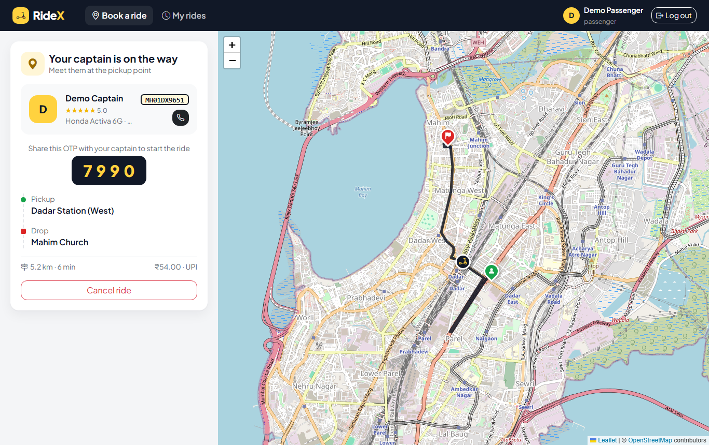
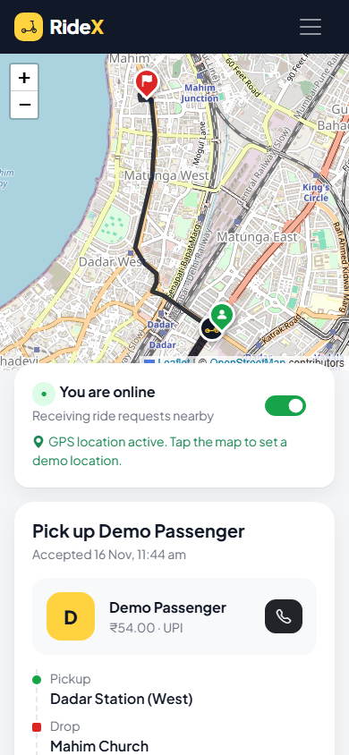
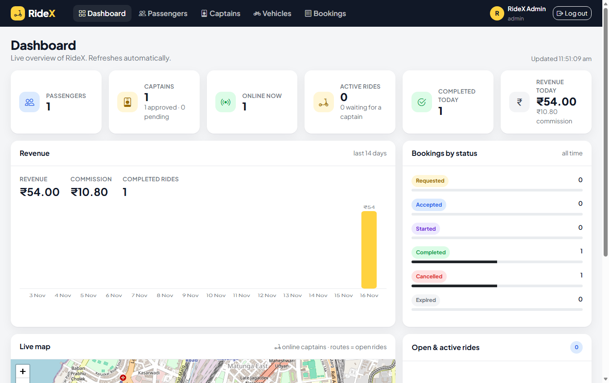

# RideX: bike taxi booking

A full-stack bike-taxi booking web app inspired by Rapido, built as a college project with
**Java 21 · Spring Boot 4 · Spring Security · Spring Data JPA · Flyway · Neon PostgreSQL ·
Bootstrap 5 · vanilla JavaScript · Leaflet + OpenStreetMap**.

Passengers book rides on a map and track their captain live. Captains go online, accept nearby
requests and track their earnings. Admins approve captains, manage users and vehicles, and watch
every ride on a live map.

| Passenger: live ride | Captain: ride on a phone | Admin dashboard |
|---|---|---|
|  |  |  |

## Features

**Passenger**
- Sign up / log in; pick pickup and drop by address search, tapping the map, GPS, or dragging pins
- Real road route, distance, time and an **upfront fare** before booking; Cash or UPI
- Live ride status: searching → captain assigned (name, rating, bike, plate, call button, **OTP**)
  → on trip → arrived; captain's position shown on the map
- Cancel before the ride starts; rate the captain (1–5 stars + comment); ride history

**Captain (driver)**
- Sign up with licence number; add licence expiry, bike details and upload licence, RC and ID proof
- Admin approval workflow (pending → approved / rejected with a reason → resubmit)
- Online/offline switch, GPS heartbeat every 15 s (or tap the map to set a demo location)
- Nearby request feed (5 km), accept or skip, start the ride with the passenger's OTP, complete and collect payment
- Earnings for today / 7 days / 30 days with a daily chart, rating, ride history

**Admin**
- Dashboard: passengers, captains, online now, active rides, today's revenue and commission
- 14-day revenue chart, bookings by status, live map of open rides and online captains
- Review captains with their documents and approve or reject; block / unblock passengers;
  activate / deactivate vehicles; browse all bookings with full details

## How it works

- **Server-side fares.** The browser never sends a price. The server recalculates the route and fare at booking time:
  `fare = max(₹30, ₹20 + ₹6/km + ₹0.5/min)`, rounded to whole rupees. The platform takes a 20% commission.
- **No double booking.** Accepting is a single conditional SQL update
  (`… WHERE id = ? AND status = 'REQUESTED'`), so when two captains tap Accept at the same instant exactly one wins.
  Partial unique indexes also stop a captain holding two rides, or a passenger opening two bookings.
- **Dispatch.** A request reaches every approved, online, free captain within 5 km whose GPS is less than 2 minutes old,
  using a Haversine `distance_km()` SQL function. Unanswered requests expire after 3 minutes.
- **Replaceable routing.** `RoutingService` uses the public OSRM server and falls back to a straight-line estimate,
  so booking keeps working if OSRM is down. Address search goes through the server to respect Nominatim's usage policy.
- **Security.** Session cookie + CSRF token, BCrypt, role rules on every page and API, uploads checked by file signature,
  and every error returned as ProblemDetail JSON.

The full design is in **[docs/PLAN.md](docs/PLAN.md)**: architecture, ER diagram, every API endpoint, page list and design decisions.
The college report is in **[docs/PROJECT_REPORT.md](docs/PROJECT_REPORT.md)**.

## Run it locally

**Prerequisites:** JDK 21 and a Neon project. Maven is not needed: the bundled `mvnw` wrapper downloads it.

1. **Database variables.** Either let the Neon CLI write them:
   ```bash
   npx neon@latest init --org-id <org-id> --project-id <project-id> --branch production --services postgres
   npx neon@latest deploy        # writes DATABASE_URL and DATABASE_URL_UNPOOLED into .env.local
   ```
   or copy [.env.example](.env.example) to `.env.local` and paste both connection strings from the Neon console (**Connect**).
2. **Admin account.** Add to `.env.local` (there is no admin sign-up page):
   ```properties
   ADMIN_EMAIL=admin@ridex.local
   ADMIN_PASSWORD=<8+ characters>
   ```
3. **Start** (from the project root, so `.env.local` is found):
   ```bash
   ./mvnw spring-boot:run          # Windows: mvnw.cmd spring-boot:run
   ```
   Flyway creates the tables on first start. Open http://localhost:8080.

`.env` and `.env.local` are gitignored. Never commit them.

## Demo walkthrough

Use two browsers, or one normal and one private window, because each keeps its own login.

1. **Captain:** sign up via *Become a captain*, then fill in licence, bike and the three documents on *Profile & documents*.
2. **Admin:** log in with `ADMIN_EMAIL`, open **Captains**, click **Review**, open the documents and **Approve**.
3. **Captain:** open **Dashboard**, allow location (or tap the map to place yourself) and switch **online**.
4. **Passenger:** sign up, set pickup near the captain and a drop, check the fare, **Book ride**.
5. **Captain:** the request appears; **Accept**. The passenger now sees the captain card and an OTP.
6. **Captain:** enter the OTP, **Start ride**, then **Complete ride**.
7. **Passenger:** rate the ride. **Admin:** the dashboard shows today's ride, revenue and commission.

## Tests

```bash
./mvnw verify
```

16 tests. Tests that touch the database run against the Neon database in `.env.local` and delete only the rows they create.

| Test | Proves |
|---|---|
| `RideFlowTest` | Full ride on Neon: **two captains race to accept, exactly one wins**; wrong OTP rejected; payment split; rating once; cancel, captain release and auto-expiry; blocked passenger can't book |
| `SecurityAccessTest` | Each role is locked out of the others' pages and APIs; CSRF required; register → login; field validation messages |
| `FareServiceTest` | Fare formula, minimum fare, rounding, 20% commission |
| `NeonUrlTest` | Neon `postgresql://` URL → JDBC URL + credentials |
| `DatabaseConnectionTest` | Live read and write on Neon |

Beyond the automated suite, the UI was verified in headless Edge:
- every page loaded at desktop and phone width with no console errors;
- a 26-step click-through of the whole product with separate passenger, captain and admin browsers. It covers:
  sign-up forms, document upload, approval and rejection, going online, address search, booking, accept, OTP,
  complete, rating, history, earnings, cancel and release, blocking, vehicle deactivation and logout.

## Project structure

```
src/main/java/com/ridex/
  config/       AppProperties (ridex.* settings), DatabaseConfig (Neon URL → JDBC), AdminSeeder
  security/     SecurityConfig (rules, JSON login, CSRF), AppUser, AppUserDetailsService
  controller/   Auth, Passenger, Driver, Admin, Geo REST controllers
  service/      BookingService (ride lifecycle, dispatch, expiry), DriverService, AdminService,
                FareService, AuthService, BookingMapper; routing/ (OSRM, Nominatim)
  repository/   Spring Data repositories (incl. atomic accept + nearby-driver queries)
  entity/ dto/ enums/ exception/
src/main/resources/
  application.yml               all settings; secrets only via environment variables
  db/migration/V1__init_schema.sql
  static/                       index/login/register + passenger/, driver/, admin/ pages (HTML + JS)
docs/                           PLAN.md, PROJECT_REPORT.md, DEPLOYMENT.md, screenshots/
```

## Deployment

See [docs/DEPLOYMENT.md](docs/DEPLOYMENT.md): Railway builds this Maven project directly, with no Docker needed.

## Credits

Map data © [OpenStreetMap](https://www.openstreetmap.org/copyright) contributors · routing by
[OSRM](https://project-osrm.org/) · geocoding by [Nominatim](https://nominatim.org/).
The public OSRM and Nominatim servers are for light, non-commercial use, which suits a college demo.
