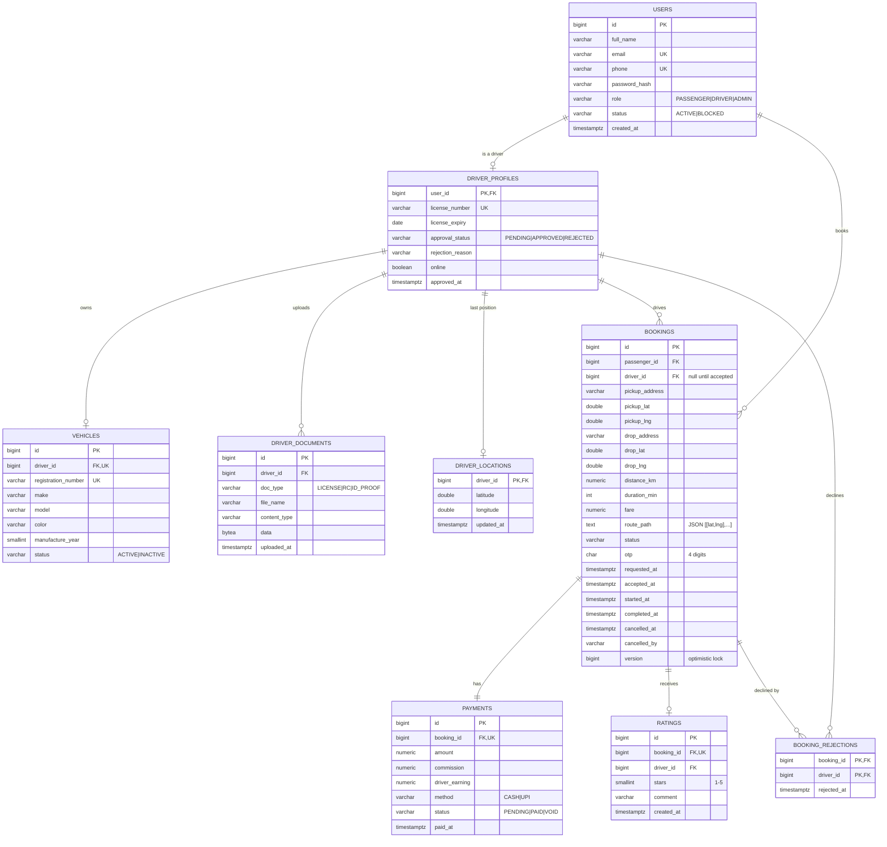

# CabZen – Architecture & Implementation Plan

Source of truth for architecture, schema, API surface, pages and roadmap. All 10 phases are implemented;
this file describes the system as built. Update it when a decision changes.

## 1. System architecture

```
 Browser: Passenger / Driver / Admin pages
 HTML + Bootstrap + vanilla JS + Leaflet
   │  fetch() JSON · session cookie + CSRF header · polls every 4 s for live status
   ▼
┌──────────── Spring Boot 4.x, one JAR (modular monolith) ─────────────────────┐
│ Static pages: /, /passenger/**, /driver/**, /admin/**                        │
│ Security filter chain: session auth · BCrypt · role rules · CSRF             │
│ Controllers (/api/**) ──► Services (@Transactional business rules)           │
│   Auth · Passenger · Driver   Booking state machine · Dispatch · Fare        │
│   Admin · Geo                 Rating · Admin analytics · Expiry job          │
│            │                              │                                  │
│   Repositories (Spring Data JPA)    RoutingService (replaceable)              │
│            │                        GeocodingService                         │
│ GlobalExceptionHandler → ProblemDetail JSON                                  │
└────────────┼──────────────────────────────┼──────────────────────────────────┘
             ▼                              ▼
   Neon PostgreSQL (Flyway)       OSRM (routes) · Nominatim (address search)
                                  OSM map tiles load straight into Leaflet
```

### Key decisions

| Decision | Why | Rejected alternative |
|---|---|---|
| Spring Boot serves the frontend (same origin) | No CORS, one deployable, cookies just work | Separate frontend host |
| Session cookie + CSRF, not JWT | HttpOnly cookie can't be read by injected scripts; logout = end session; no refresh-token code | JWT in localStorage |
| Flyway from V1, Hibernate `ddl-auto=validate` | Schema is versioned SQL from day one; Hibernate never changes it | `ddl-auto=update`, switch later |
| Fixed fare set by the server at booking (Rapido model) | Browser can't tamper with fare | Metered fare |
| Broadcast request to nearby drivers, first accept wins | Simple, demo-able, safe via one atomic UPDATE | Sequential offer to nearest driver (upgrade path) |
| Polling every 4 s, paused when tab hidden | Nothing extra to run, easy to explain | SSE / WebSockets (upgrade path, both built into Spring) |
| `RoutingService` interface | Replaceable routing: `OsrmRoutingService` (public OSRM) with a straight-line × 1.3 fallback | Calling OSRM from the browser |
| Driver documents in Postgres (`bytea`, ≤ 2 MB) | Cloud hosts wipe local disk; no extra storage service | Local `uploads/`, S3 |
| Aggregates (avg rating, earnings, revenue) computed by SQL | Always correct, nothing to drift | Stored counters |
| lat/lng as `double precision` + Haversine in SQL | Enough at city scale | PostGIS (upgrade path) |
| Spring Boot 4.x | 3.x is out of free support | — |

**Fare (defaults, in `application.yml`):** `max(₹30, ₹20 + ₹6/km + ₹0.5/min)`, platform commission 20%.
Trip minutes = OSRM's time, but never faster than 22 km/h: public OSRM times free-flowing cars, which
understates a bike taxi in city traffic. The straight-line fallback uses the same 22 km/h.

**Payments:** no real gateway (not in the stack). Passenger picks Cash or UPI. Payment row is
PENDING at booking, PAID when the driver completes the ride (confirms collection), VOID on cancel.

## 2. ER diagram



**Shared driver ID:** `driver_profiles.user_id` is both PK and FK (`@MapsId`), so a driver has one
ID everywhere. `bookings.driver_id` references `driver_profiles`, so only real drivers can be assigned.

### Constraints and indexes
- Enums are `varchar` + CHECK (`@Enumerated(STRING)`; native PG enums fight Hibernate).
- One active ride per driver: `UNIQUE(driver_id) WHERE status IN ('ACCEPTED','STARTED')`.
- One open booking per passenger: `UNIQUE(passenger_id) WHERE status IN ('REQUESTED','ACCEPTED','STARTED')`.
- `CHECK (status IN ('REQUESTED','EXPIRED','CANCELLED') OR driver_id IS NOT NULL)`.
- CHECKs: stars 1–5, fare ≥ 0, lat/lng in range; `UNIQUE(driver_id, doc_type)` on documents.
- Indexes: `bookings(status, requested_at)`, `bookings(passenger_id, requested_at DESC)`,
  `bookings(driver_id, requested_at DESC)`, `driver_locations(latitude, longitude)`,
  `payments(paid_at) WHERE status='PAID'`.
- FKs `ON DELETE RESTRICT`; users are blocked, never deleted.

### Booking status flow
```
REQUESTED ──accept──► ACCEPTED ──start (OTP)──► STARTED ──complete──► COMPLETED
   │                     │
   ├──── cancel ─────────┴──► CANCELLED   (passenger, or driver before start)
   └──── no accept in 3 min ─► EXPIRED     (scheduled job)
```

## 3. Folder structure

```
├── CLAUDE.md  README.md  .env.example  .gitignore  pom.xml  mvnw  mvnw.cmd  .mvn/
├── docs/                      this plan; Phase 10 report material
└── src/
    ├── main/java/com/cabzen/
    │   ├── config/       AppProperties, DatabaseConfig (Neon URL → JDBC), AdminSeeder
    │   ├── security/     SecurityConfig (rules, JSON login/logout, CSRF), AppUser, AppUserDetailsService
    │   ├── controller/   Auth, Geo, Passenger, Driver, Admin controllers
    │   ├── service/      AuthService, BookingService (lifecycle + dispatch + expiry job), BookingMapper,
    │   │                 DriverService, AdminService, FareService, Reports
    │   │   └── routing/  RoutingService, OsrmRoutingService, GeocodingService
    │   ├── repository/   one Spring Data repository per entity
    │   ├── entity/       User, DriverProfile, Vehicle, DriverDocument, DriverLocation, Booking, Payment, Rating
    │   │                 (booking_rejections is written by a native insert, no entity needed)
    │   ├── dto/          records: auth/, booking/, driver/, admin/, geo/
    │   ├── enums/        Role, AccountStatus, ApprovalStatus, VehicleStatus, DocumentType,
    │   │                 BookingStatus, PaymentMethod, PaymentStatus
    │   └── exception/    ApiException, GlobalExceptionHandler
    ├── main/resources/
    │   ├── application.yml
    │   ├── db/migration/ V1__init_schema.sql, ...
    │   └── static/       index/login/register.html, css/, js/ (api.js, ui.js, map.js),
    │                     passenger/, driver/, admin/  (page.html + page.js pairs)
    └── test/java/com/cabzen/
```

## 4. API endpoints

JSON everywhere. Errors use ProblemDetail: `{status, title, detail, errors[]}`.

**Auth** (public unless noted)
| Method | Path | Purpose |
|---|---|---|
| POST | `/api/auth/register/passenger` | name, email, phone, password |
| POST | `/api/auth/register/driver` | same + licence number; profile PENDING |
| POST | `/api/auth/login` | email + password → `{role, redirectUrl}` |
| POST | `/api/auth/logout` | end session |
| GET | `/api/auth/me` | current user (logged-in); also sets CSRF cookie |

**Geo** (any logged-in user)
| Method | Path | Purpose |
|---|---|---|
| GET | `/api/geo/search?q=` | address → coordinates (Nominatim via server, cached) |
| GET | `/api/geo/reverse?lat=&lng=` | coordinates → address |

**Passenger** (PASSENGER)
| Method | Path | Purpose |
|---|---|---|
| POST | `/api/passenger/estimate` | pickup + drop → distance, duration, fare, route |
| POST | `/api/passenger/bookings` | create; server recalculates fare; 409 if no driver nearby / already has open ride |
| GET | `/api/passenger/bookings/active` | current ride; driver, bike, OTP once accepted (polled) |
| GET | `/api/passenger/bookings` | history (latest 50) |
| GET | `/api/passenger/bookings/{id}` | one ride (own only) |
| POST | `/api/passenger/bookings/{id}/cancel` | while REQUESTED or ACCEPTED |
| POST | `/api/passenger/bookings/{id}/rating` | 1–5 stars + comment; completed rides, once (204) |

**Driver** (DRIVER)
| Method | Path | Purpose |
|---|---|---|
| GET / PUT | `/api/driver/profile` | licence details, approval status |
| PUT | `/api/driver/vehicle` | add/update bike |
| POST / GET | `/api/driver/documents` | upload (pdf/jpg/png ≤ 2 MB) / list |
| PUT | `/api/driver/availability` | `{online}`; 403 unless approved with active bike |
| PUT | `/api/driver/location` | `{lat, lng}` every 15 s while online |
| GET | `/api/driver/requests` | nearby open requests, nearest first (polled) |
| POST | `/api/driver/bookings/{id}/accept` | atomic; 409 if taken |
| POST | `/api/driver/bookings/{id}/reject` | hide from this driver |
| GET | `/api/driver/bookings/active` | current ride + passenger + route |
| POST | `/api/driver/bookings/{id}/start` | `{otp}` |
| POST | `/api/driver/bookings/{id}/complete` | ends ride, payment PAID |
| POST | `/api/driver/bookings/{id}/cancel` | before start only; the ride goes back to other nearby captains |
| GET | `/api/driver/earnings` | today / 7-day / 30-day totals, rating, last 7 days per day |
| GET | `/api/driver/bookings` | history (latest 50) |

**Admin** (ADMIN)
| Method | Path | Purpose |
|---|---|---|
| GET | `/api/admin/stats` | counts + today's revenue |
| GET | `/api/admin/analytics?days=30` | revenue, commission, rides per day; status breakdown |
| GET | `/api/admin/passengers` | list with ride counts (search is client-side) |
| PATCH | `/api/admin/users/{id}/status` | ACTIVE / BLOCKED |
| GET | `/api/admin/drivers?approval=` | list / pending queue |
| GET | `/api/admin/drivers/{id}` | profile, bike, documents, rating |
| GET | `/api/admin/documents/{docId}` | download document |
| POST | `/api/admin/drivers/{id}/approve` · `/reject` | reject needs `{reason}` |
| GET | `/api/admin/vehicles` | list |
| PATCH | `/api/admin/vehicles/{id}/status` | ACTIVE / INACTIVE |
| GET | `/api/admin/bookings?status=` | latest 200 bookings |
| GET | `/api/admin/live` | open/active rides with routes + online captains' positions (polled) |

Pages: `/passenger/**`, `/driver/**`, `/admin/**` need the matching role; anonymous → `/login.html`,
wrong role → that user's own home page (APIs answer 403).
No admin sign-up: one admin is created at startup from `ADMIN_EMAIL` / `ADMIN_PASSWORD`; its password is
re-synced from `ADMIN_PASSWORD` on every start. Blocking a user expires their open sessions at once
(Spring Security `SessionRegistry`): the next API call gets 401 "blocked".

## 5. Frontend pages

| Page | Role | Contents |
|---|---|---|
| `index.html` | public | landing: hero, how it works, CTAs |
| `login.html` | public | one form; redirect by role |
| `register.html` | public | Passenger / Driver tabs |
| `passenger/home.html` | P | map; pickup/drop by search, click, GPS; route + fare; book; live status panel; rate prompt |
| `passenger/history.html` | P | rides, status badges, receipt, rate unrated rides |
| `driver/onboarding.html` | D | profile, bike, documents, approval banner |
| `driver/home.html` | D | online switch, location updates, request cards, active ride map, OTP, complete |
| `driver/earnings.html` | D | today/week/month cards, per-day bars, history |
| `admin/dashboard.html` | A | stat cards, revenue chart (SVG), live active-rides map |
| `admin/passengers.html` | A | search, block/unblock |
| `admin/drivers.html` | A | pending queue, document viewer, approve/reject, block/unblock |
| `admin/vehicles.html` | A | table, activate/deactivate |
| `admin/bookings.html` | A | filter by status/date, detail panel |

## 6. Roadmap

Stop after every phase for approval. A phase is done when `mvnw verify` passes and it's checked by hand.

| Phase | What gets built | Done when |
|---|---|---|
| 1. Setup + Neon | git, pom, Maven Wrapper, `application.yml` from env vars, `.env.example`, `.gitignore`, `CLAUDE.md` | app starts, connects to Neon, Flyway runs |
| 2. Entities | `V1__init_schema.sql`, entities, enums, repositories | Hibernate validate passes; save/load test on Neon dev branch |
| 3. Security | BCrypt, register/login/logout/me, role rules, CSRF, exception handler, admin seed | each role gets 403 on other roles' APIs |
| 4. Passenger UI | design system, shared JS, passenger pages, Leaflet click-to-pick, Haversine estimate | fare estimate works on real map |
| 5. Driver UI | onboarding, availability, location, admin approve/reject API | driver uploads docs, gets approved, goes online |
| 6. Booking + dispatch | status flow, dispatch, atomic accept, reject, OTP, complete + payment, cancel, expiry, rating | full ride in two browsers; 2-thread accept test → exactly 1 winner |
| 7. Maps + routing | OSRM + fallback, Nominatim proxy + cache, route lines | road distance shown; fallback works with OSRM disabled |
| 8. Admin | dashboard, analytics, management pages, live map | all admin pages show real data |
| 9. Testing | unit, integration, security tests; bug fixes; mobile checks | all tests pass |
| 10. Deploy + docs | Railway/Render, README, report material | public URL works; docs ready |

## 7. Risks and mitigations

| Risk | Mitigation |
|---|---|
| Neon scale-to-zero: slow first query, idle connections dropped | pool of 5, `max-lifetime` 4 min, keepalive 2 min, `sslmode=require` |
| Flyway through Neon's PgBouncer pooler | direct host (no `-pooler`) |
| Neon URL isn't JDBC | `config/DatabaseConfig` converts Neon's `DATABASE_URL_UNPOOLED` to JDBC URL + credentials |
| Two drivers accept the same ride | conditional UPDATE (0 rows → 409) + partial unique index + `@Version` + concurrency test |
| Public OSRM: rate limits, no SLA | server-side, timeout, cache, Haversine × 1.3 fallback, swappable |
| Nominatim policy (1 req/s, identify app, no autocomplete) | search on submit, server proxy with generic User-Agent, cache |
| Ghost drivers (tab closed, still online) | dispatch ignores locations older than 2 min; a job takes captains with no GPS for 10 min offline (not mid-ride) |
| CSRF with fetch() | Spring Security SPA CSRF config; `api.js` sends header |
| Fare tampering | server recalculates from coordinates |
| Unsafe uploads | 2 MB, type whitelist, admin-only download |
| Geolocation needs HTTPS | localhost OK; host provides HTTPS |
| No H2 allowed | Mockito unit tests; integration tests on a Neon test branch |
| Time zones | store UTC; group by Asia/Kolkata |
| Passenger + driver in one browser share cookies | demo with two browsers / incognito |
| Secrets in git | `.env` gitignored from first commit |
| Neon free tier (0.5 GB) | small docs only |
