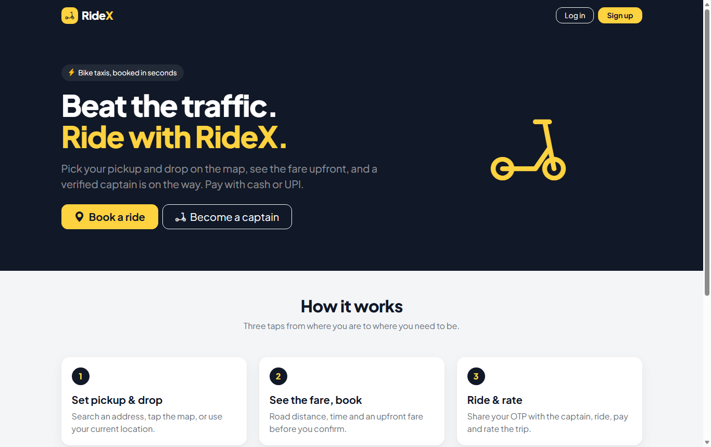
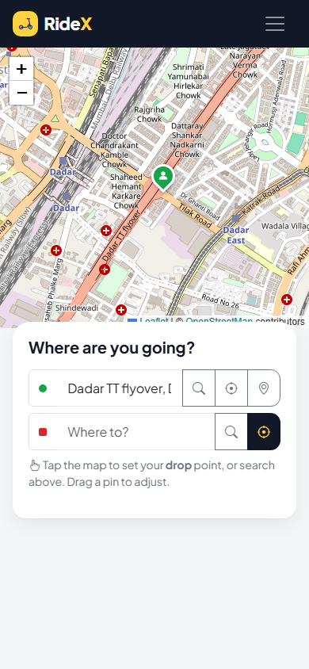
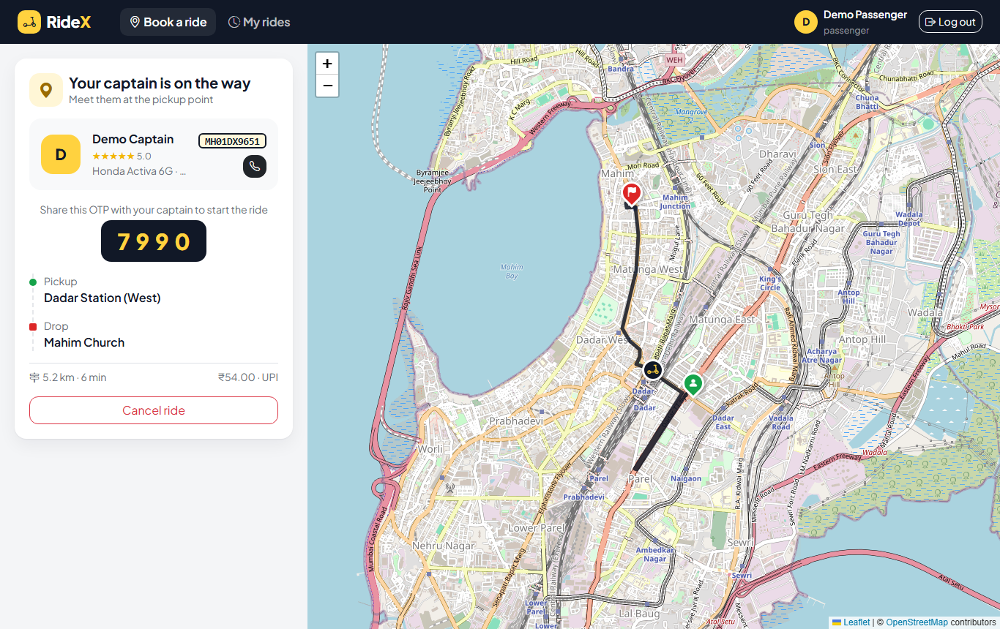
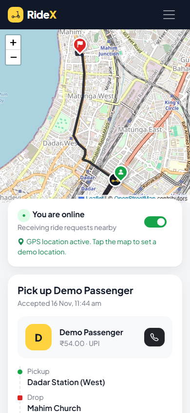
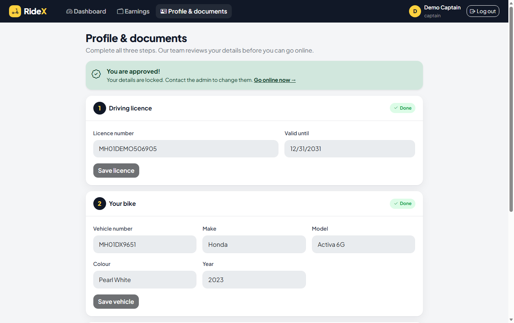
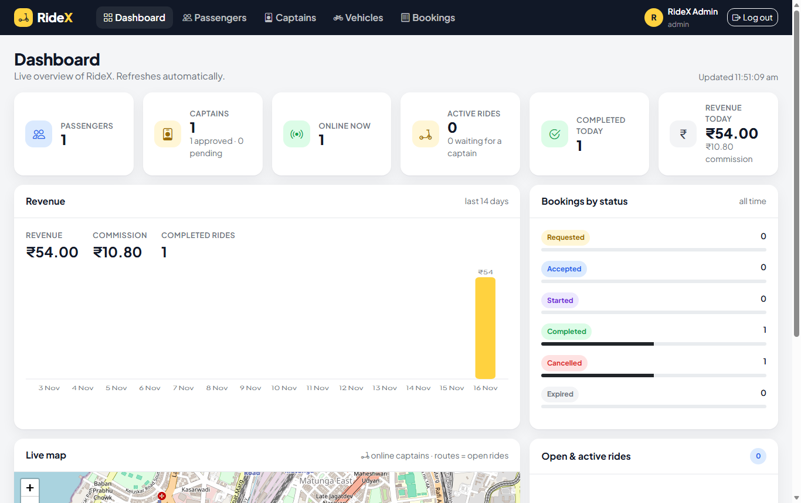

# RideX: Bike Taxi Booking System

**Project report**

## 1. Abstract

RideX is a web application for booking bike taxis, modelled on services like Rapido. A passenger
chooses a pickup and drop point on a map, sees the road distance and an upfront fare, and books a ride.
Nearby verified captains (drivers) receive the request; the first to accept is assigned, and the
passenger follows the ride live until drop-off, payment and rating. An admin console handles captain
verification, user and vehicle management, and live monitoring of the platform.

The system is a Spring Boot modular monolith on Java 21 with a Neon PostgreSQL database, a vanilla
JavaScript + Bootstrap frontend, and Leaflet/OpenStreetMap maps. Particular attention went to correctness
under concurrency (two captains can never get the same ride), server-side trust (fares are always
computed on the server), and role-based security.

## 2. Problem statement

Short city trips by car or auto-rickshaw are slow and costly in traffic. Bike taxis are faster and
cheaper, but they need a platform that can:
- match a passenger with a nearby, verified rider in real time;
- show a fair price before the trip;
- make sure exactly one rider accepts each request;
- let the operator verify riders and monitor the service.

## 3. Objectives

1. Three role-based interfaces: Passenger, Captain and Admin.
2. Map-based booking with real road distance and an upfront fare.
3. Automatic dispatch to approved, online captains near the pickup.
4. A safe ride lifecycle: atomic acceptance, OTP-verified start, completion with payment records.
5. Captain onboarding with document upload and an admin approval workflow.
6. Earnings and analytics dashboards computed from real data.
7. Secure authentication, role-based authorization, validation and consistent error handling.

## 4. Modules

| Module | Users | Main functions |
|---|---|---|
| Authentication | all | Sign-up (passenger / captain), login, logout, session, role-based home page |
| Booking | passenger | Map trip planner, address search, fare estimate, book, live tracking, cancel, rate, history |
| Captain onboarding | captain | Licence details, bike details, document upload, approval status |
| Captain operations | captain | Online/offline, GPS updates, nearby requests, accept/skip, OTP start, complete, earnings |
| Dispatch & lifecycle | system | Nearby-captain search, atomic accept, automatic expiry of unanswered requests |
| Administration | admin | Dashboard, analytics, passenger and captain blocking, captain approval, vehicle status, bookings, live map |
| Maps & routing | all | Leaflet maps, OSRM road routes, Nominatim address search, straight-line fallback |

## 5. Technology stack

| Layer | Technology | Why |
|---|---|---|
| Language / runtime | Java 21 (LTS) | Modern language features (records, switch expressions), long-term support |
| Framework | Spring Boot 4.1 | Production-grade web, data and security support with minimal configuration |
| Security | Spring Security 7 | Session authentication, BCrypt, CSRF protection, URL-level role rules |
| Persistence | Spring Data JPA (Hibernate 7) | Repositories, derived queries, entity graphs, optimistic locking |
| Database | Neon PostgreSQL 18 | Serverless Postgres with branching and scale-to-zero; partial indexes and SQL functions |
| Migrations | Flyway | Versioned, repeatable schema (`V1__init_schema.sql`); Hibernate only validates |
| Frontend | HTML, CSS, vanilla JavaScript, Bootstrap 5 | No build step; responsive, mobile-first UI |
| Maps | Leaflet + OpenStreetMap, OSRM, Nominatim | Free, open map data, road routing and geocoding |
| Build | Maven (wrapper) | Reproducible builds without a global Maven install |

## 6. System architecture

```
 Browser (Passenger / Captain / Admin pages: HTML + Bootstrap + JS + Leaflet)
        │  JSON over HTTPS · session cookie + CSRF header · polling every 4–10 s
        ▼
 Spring Boot application (one JAR)
   Security filter chain ─ role rules for /passenger/**, /driver/**, /admin/** and /api/**
   Controllers (REST)    ─ Auth, Passenger, Driver, Admin, Geo
   Services              ─ BookingService (lifecycle, dispatch, expiry job), DriverService,
                           AdminService, FareService, routing/ (OSRM, Nominatim)
   Repositories (JPA)    ─ derived queries, native SQL for dispatch and reports
   GlobalExceptionHandler ─ every error as ProblemDetail JSON
        │                                  │
        ▼                                  ▼
 Neon PostgreSQL (Flyway schema)     OSRM routing · Nominatim geocoding · OSM tiles
```

**Main design decisions** (full table in [PLAN.md](PLAN.md)):

| Decision | Reason |
|---|---|
| Session cookie + CSRF, not JWT | Same-origin app; the HttpOnly cookie can't be stolen by scripts; logout simply ends the session |
| Server computes every fare | The browser can't tamper with prices |
| Conditional SQL update for accept | The database guarantees a single winner without extra locking code |
| Polling instead of WebSockets | Simple and reliable at this scale; easy to upgrade later |
| Routing behind an interface | The provider can be swapped (self-hosted OSRM, GraphHopper) without touching callers |
| Documents stored in Postgres | Survive redeploys on hosts with temporary disks; no extra storage service |

## 7. Database design

ER diagram and the complete column list: [PLAN.md § 2](PLAN.md#2-er-diagram).

| Table | Purpose | Key constraints |
|---|---|---|
| `users` | All accounts (passenger, captain, admin) | unique email and phone; role and status CHECKs |
| `driver_profiles` | Captain data, approval status, online flag | primary key = `users.id` (shared key); unique licence number |
| `vehicles` | One bike per captain | unique registration number; status ACTIVE/INACTIVE |
| `driver_documents` | Licence, RC, ID proof files (`bytea`) | one document per type per captain |
| `driver_locations` | Last GPS position per captain | latitude/longitude range CHECKs |
| `bookings` | Every ride and its full lifecycle | **partial unique indexes**: one active ride per captain, one open booking per passenger; captain required once accepted; optimistic-lock `version` |
| `booking_rejections` | Requests a captain skipped | composite primary key (booking, captain) |
| `payments` | Amount, commission, captain earning, method, status | one payment per booking |
| `ratings` | 1–5 stars + comment | one rating per booking; stars CHECK 1–5 |

All foreign keys block deletion, so ride history can't be lost by accident; accounts are blocked rather than deleted.

## 8. Key algorithms

### 8.1 Fare calculation
```
fare = max(minimum, base + perKm × distanceKm + perMin × durationMin), rounded to whole rupees
     = max(₹30, ₹20 + ₹6/km + ₹0.5/min)
commission = 20% of fare;  captain earning = fare − commission
```
Example: 5.15 km, 6 min → 20 + 30.9 + 3 = 53.9 → **₹54**; commission ₹10.80; captain earns ₹43.20.
All values are configurable in `application.yml`.

### 8.2 Finding nearby captains (dispatch)
A SQL function computes great-circle (Haversine) distance:
```sql
distance_km = 6371 × 2 × asin(√(sin²(Δlat/2) + cos(lat1)·cos(lat2)·sin²(Δlng/2)))
```
A captain is offered a request when they are approved, online, have an active bike and account, sent
GPS within the last 2 minutes, are within 5 km of the pickup, have no active ride, and haven't skipped it.
Requests are sorted by distance to the pickup.

### 8.3 Race-free acceptance
Two captains may tap **Accept** at the same moment. RideX lets the database decide:
```sql
UPDATE bookings SET driver_id = :driver, status = 'ACCEPTED', accepted_at = now(), version = version + 1
WHERE id = :id AND status = 'REQUESTED'
```
PostgreSQL row locking makes the second update wait, then re-check `status = 'REQUESTED'`, which is now
false. It updates 0 rows, and that captain gets *"Sorry, this ride was already taken"*. A partial unique
index (`UNIQUE(driver_id) WHERE status IN ('ACCEPTED','STARTED')`) also makes it impossible for one
captain to hold two rides. `RideFlowTest` runs both captains on parallel threads and asserts exactly one wins.

### 8.4 Ride lifecycle
```
REQUESTED ──accept──► ACCEPTED ──start (OTP)──► STARTED ──complete──► COMPLETED
   │                     │ └─ captain cancels → back to REQUESTED for other captains
   ├──── passenger cancels ─► CANCELLED (payment VOID)
   └──── no accept in 3 min ─► EXPIRED (payment VOID, scheduled job every 30 s)
```
- **OTP:** a random 4-digit code (`SecureRandom`), shown only to the passenger. The captain must enter it
  to start, which proves the right passenger is on board.
- **Completion:** marks the payment PAID and splits it into commission and captain earning.

## 9. Security

- Passwords hashed with **BCrypt**; the hash is erased from the session after login.
- **Role-based authorization** on both pages and APIs. A passenger opening an admin page or API gets 403;
  anonymous API calls get 401, and anonymous page visits redirect to login.
- **CSRF protection**: the token travels in a cookie and must be echoed in a header on every write.
- **Input validation** with Jakarta Bean Validation; errors come back per field.
- **Uploads**: max 2 MB, file type verified from its first bytes (PDF/PNG/JPEG), downloadable by admins only.
- **Secrets** only come from environment variables / gitignored `.env.local`; nothing sensitive is in the repository.
- Business rules are enforced on the server: fare recalculation, ownership checks on every ride, blocked accounts cannot book.

## 10. Testing

| Level | What | Result |
|---|---|---|
| Unit | Fare formula, Neon URL conversion, admin account seeding | 9 tests pass |
| Integration (live Neon DB) | Full ride flow incl. two-captain race, cancel, release, expiry, blocked user, silent captain taken offline; DB read/write | 4 tests pass |
| Security (MockMvc) | Role isolation, CSRF, register + login, blocking ends an open session, validation errors | 6 tests pass |
| Startup | Context loads, Flyway migrates, Hibernate validates every entity against the schema | 1 test passes |
| End-to-end over HTTP | 33 checks: sign-up, onboarding, fake-file rejection, approval, booking, tampered fare ignored, accept, wrong OTP, complete, rating, dashboards, every page per role, logout | all pass |
| Browser | Every page loaded in headless Edge at 1366 px and 390 px width | no console errors |
| UI click-through | 26 steps with separate passenger / captain / admin browsers: sign-up forms, uploads, approval and rejection, online switch, address search, book, accept, wrong and right OTP, complete, rating, history, earnings, captain release, cancel, block / unblock, vehicle deactivation, logout | all pass, no console errors |

Run `./mvnw verify` to repeat the automated suite (20 tests).

## 11. Screenshots

| | |
|---|---|
| Landing page  | Passenger trip planner (phone)  |
| Passenger live ride  | Captain ride view (phone)  |
| Captain onboarding  | Admin dashboard  |

## 12. Limitations and future scope

| Limitation | Possible enhancement |
|---|---|
| Live updates by polling (every 4–10 s) | Server-Sent Events or WebSockets (both built into Spring) |
| Payments are recorded, not processed | Integrate a payment gateway (e.g. Razorpay) for UPI and cards |
| Requests are broadcast to all nearby captains | Offer to the nearest captain first, with timeouts, as large platforms do |
| Public OSRM / Nominatim servers (rate-limited) | Self-hosted OSRM or a commercial routing API |
| Admin lists show the latest 50–200 records | Server-side paging and date filters |
| No password reset or phone OTP login | Email/SMS verification flows |

## 13. Conclusion

RideX implements the complete bike-taxi workflow end to end: verified captains, map-based booking with
upfront fares, race-free dispatch, OTP-secured rides, payments and ratings, and an admin console with live
monitoring. The automated tests prove the hardest part, concurrency, against the real database. The layered
Spring Boot design keeps each concern (security, booking rules, routing, persistence) in one place, so the
system is easy to extend with the enhancements above.

## 14. References

- Spring Boot reference documentation: https://docs.spring.io/spring-boot/
- Spring Security reference: https://docs.spring.io/spring-security/reference/
- PostgreSQL documentation (partial indexes, row locking): https://www.postgresql.org/docs/
- Neon documentation: https://neon.com/docs
- Flyway documentation: https://documentation.red-gate.com/flyway
- Leaflet: https://leafletjs.com/ · OpenStreetMap: https://www.openstreetmap.org/copyright
- OSRM API: https://project-osrm.org/docs/v5.24.0/api/ · Nominatim usage policy: https://operations.osmfoundation.org/policies/nominatim/
